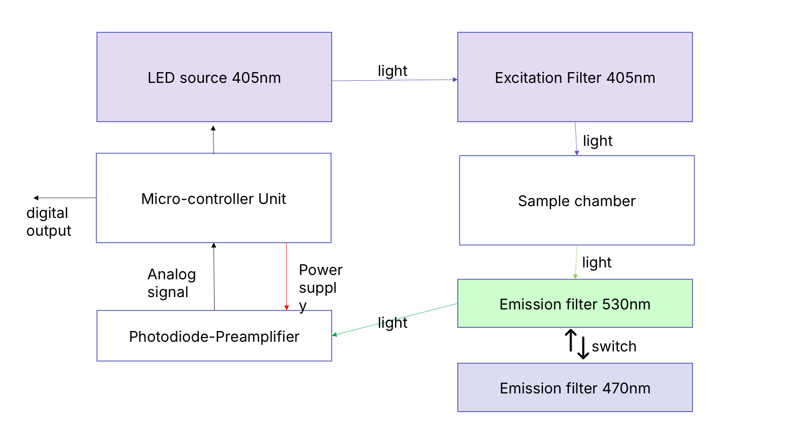

# Optoelectronic instrumentation — design project and laboratory work

Coursework for **Instrumentação Optoelectrónica**, University of Coimbra, Erasmus 2019/2020 (group 18).

## 1 · Low-cost cancer screening through urine fluorescence — `01-urine-fluorescence-cancer-detection/`

Many metabolites in urine (e.g. NADH) are native fluorophores, and the emission spectra of healthy subjects and cancer patients differ significantly. Commercial spectrofluorometers are expensive, so we designed two instruments (with Giulio Steyde):

- **Low-cost design (~€350)**: 405 nm LED excitation, two switchable emission filters (470 nm and 530 nm) and a photodiode with preamplifier read by a microcontroller — measuring at two wavelengths is enough for >90 % sensitivity in the literature.
- **Full spectrofluorometer (~€3 100)**: excitation and emission monochromators, 405 nm excitation, 460–625 nm emission scan.

## 2–4 · Laboratory work

| Folder | Topic | Content |
| --- | --- | --- |
| `02-erbium-fiber-laser/` | Erbium-doped fibre laser and amplifier (1550 nm) | Measurements, small-signal gain |
| `03-laser-safety/` | Laser safety (IEC/EN 60825), He-Ne 632.8 nm and 405 nm laser diode | Data, MATLAB script for **MPE** curves |
| `04-fiber-optics/` | Optical fibre link: LED vs laser diode sources, threshold/bias, attenuation, fibre length from delay | Data and report |

## Skills

Optoelectronic system design · fluorescence spectroscopy · photodetectors · lasers and laser safety · optical fibres · MATLAB · lab measurements
